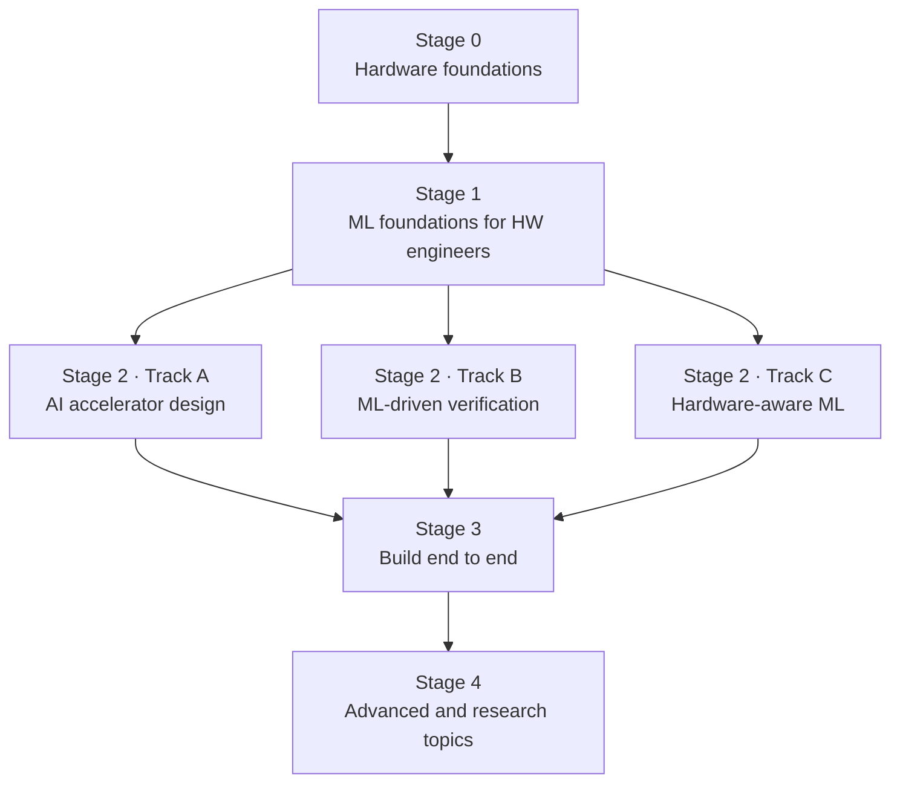

# AI Hardware Design Roadmap for FPGA & ASIC Engineers

Roadmap for FPGA &amp; ASIC engineers transitioning into AI accelerator design, ML-driven verification, and hardware-aware machine learning.

You already know how to build hardware. This roadmap shows you how to build hardware **for AI**, and how to use **AI to build hardware**, one stage and one milestone at a time.

---

## Contents

- [Who this is for](#who-this-is-for)
- [How to use this roadmap](#how-to-use-this-roadmap)
- [The three tracks](#the-three-tracks)
- [Roadmap at a glance](#roadmap-at-a-glance)
- [Stage 0: Hardware foundations](#stage-0-hardware-foundations)
- [Stage 1: ML foundations for hardware engineers](#stage-1-ml-foundations-for-hardware-engineers)
- [Stage 2: Track fundamentals](#stage-2-track-fundamentals)
- [Stage 3: Build end to end](#stage-3-build-end-to-end)
- [Stage 4: Advanced and research topics](#stage-4-advanced-and-research-topics)
- [What's in this repo](#whats-in-this-repo)
- [Contributing](#contributing)
- [License](#license)

---

## Who this is for

- **RTL / FPGA / ASIC design engineers** who want to move into AI accelerator or NPU design.
- **Verification engineers** curious about using machine learning to close coverage faster and triage failures.
- **Embedded and systems engineers** who deploy models on constrained hardware and want to understand the hardware side.
- **Students** who have done a digital design course and want a direction that is in demand.

You do **not** need a machine learning background to start. You do need curiosity and a willingness to build things.

## How to use this roadmap

1. **Go in order through Stage 0 and Stage 1.** They are short for most hardware engineers but fill the gaps that slow people down later.
2. **Pick one track in Stage 2.** You can do all three eventually, but going deep on one first is more rewarding than going wide.
3. **Use the milestones as your checklist.** Each stage ends with concrete milestones. Fork this repo and tick the boxes in your copy to track your progress.
4. **Build something in Stage 3.** Reading is not enough. A working project on a real or simulated target is what teaches you (and what gets you hired).
5. **Treat Stage 4 as a menu.** Pick topics that excite you and follow the research.

Wherever possible this roadmap favours **open-source tools** (Verilator, cocotb, Yosys, F4PGA, Amaranth, hls4ml and others) so anyone can follow along without paid EDA licenses.

## The three tracks

| Track | Question it answers | You'll end up able to |
|---|---|---|
| **A. AI accelerator design** | How do I build hardware that runs neural networks fast and efficiently? | Design and evaluate a dataflow accelerator (e.g. a systolic array CNN engine) on FPGA or in RTL. |
| **B. ML-driven verification** | How can ML help me verify hardware faster? | Apply ML to stimulus generation, coverage closure and failure triage in a Python-based testbench. |
| **C. Hardware-aware ML** | How do I shape a model so it fits real hardware? | Quantize, prune and compile a model for an FPGA or edge target and measure the trade-offs. |

The tracks overlap on purpose. An accelerator designer who understands quantization designs better datapaths, and a verification engineer who understands dataflows writes better tests.

## Roadmap at a glance

---

## Stage 0: Hardware foundations

> **Goal:** be comfortable designing, simulating and synthesising digital logic.
> If you already work as an FPGA or ASIC engineer, skim the milestones and move on.

For the full beginner path into FPGA and ASIC engineering, follow the excellent [FPGA-ASIC-Roadmap](https://github.com/m3y54m/FPGA-ASIC-Roadmap). This roadmap picks up where that one leaves off.

**Topics**

- Digital logic, finite state machines, pipelining and timing closure basics
- Verilog / SystemVerilog or VHDL, plus one Python-based HDL (e.g. Amaranth or Chisel) as a bonus
- Fixed-point arithmetic: adders, multipliers, accumulators, overflow and rounding
- Memories: BRAM / SRAM, FIFOs, banking and simple caches
- On-chip interfaces: AXI4, AXI4-Stream, AXI-Lite
- Simulation with Verilator or Icarus, and testbenches with cocotb
- Computer architecture basics: a simple RISC-V pipeline, memory hierarchy, bandwidth vs latency

📚 **Resources:** [resources/foundations.md](resources/foundations.md#stage-0-hardware-foundations)

**Milestones**

- [ ] Write, simulate and synthesise a pipelined fixed-point multiply-accumulate (MAC) unit.
- [ ] Build an AXI-Stream module with a cocotb testbench that checks it against a Python model.
- [ ] Run a small RISC-V core (e.g. SERV, darkriscv or neorv32) in simulation or on an FPGA board.
- [ ] Explain the difference between compute-bound and memory-bound in your own words.

---

## Stage 1: ML foundations for hardware engineers

> **Goal:** understand neural networks well enough to know *what the hardware has to compute and move*.

**Topics**

- Linear algebra refresher: vectors, matrices, matrix multiply, convolution as matrix multiply (im2col)
- Neural network basics: layers, activations, loss, backpropagation, training vs inference
- Key model families and their compute patterns: MLPs, CNNs, RNNs, Transformers (attention, KV cache)
- PyTorch fundamentals: tensors, building and training a small model, exporting to ONNX
- Number formats: FP32, FP16, BF16, INT8, INT4, FP8 and why they matter for area and energy
- Workload analysis: counting MACs and parameters, arithmetic intensity, the roofline model

📚 **Resources:** [resources/foundations.md](resources/foundations.md#stage-1-ml-foundations-for-hardware-engineers)

**Milestones**

- [ ] Train a small CNN (e.g. on MNIST or CIFAR-10) in PyTorch and export it to ONNX.
- [ ] Count the MACs, weights and activations per layer of that model by hand or with a script.
- [ ] Re-implement one convolution layer in plain NumPy with fixed-point integers and match PyTorch's output.
- [ ] Draw a roofline for an FPGA board you own (or a datasheet one) and place your model's layers on it.

---

## Stage 2: Track fundamentals

Pick **one** track to go deep on first. Each track has its own topics and milestones.

### Track A: AI accelerator design

> **Goal:** understand how accelerators are organised and build the core compute engine yourself.

**Topics**

- Dataflows: weight-stationary, output-stationary, row-stationary; loop tiling and loop ordering
- Systolic arrays and MAC arrays; vector and SIMD units
- Memory hierarchy for accelerators: on-chip buffers, double buffering, DMA, off-chip bandwidth
- Quantized datapaths: INT8 MACs, accumulator widths, requantization and scaling
- Nonlinear functions in hardware: ReLU, GELU, softmax, layer norm (LUTs, piecewise approximations)
- High-level synthesis (Vitis HLS or open-source alternatives) vs hand-written RTL
- Performance and energy modelling: cycle counts, utilisation, design-space exploration tools (e.g. Timeloop/Accelergy, SCALE-Sim)
- Case studies: Google TPU, NVDLA, Eyeriss, Gemmini

📚 **Resources:** [resources/accelerator-design.md](resources/accelerator-design.md)

**Milestones**

- [ ] Implement a parameterised N×N systolic array for INT8 matrix multiply in RTL, verified with cocotb.
- [ ] Add input/weight buffers with double buffering and measure utilisation in simulation.
- [ ] Map a convolution layer onto your array with tiling and compare cycle counts with an analytical model.
- [ ] Read the TPU v1 paper and one Eyeriss paper and summarise their dataflow choices.

### Track B: ML-driven verification

> **Goal:** combine solid verification practice with ML techniques that make it faster and smarter.

**Topics**

- Verification foundations: constrained-random stimulus, functional coverage, assertions, scoreboards
- Python-based verification with cocotb (and pyuvm for UVM-style structure)
- Coverage closure as an optimisation problem: what is hard to hit and why
- ML for stimulus generation: Bayesian optimisation, reinforcement learning, genetic algorithms
- ML for failure triage: clustering failing tests, log classification, root-cause hints
- LLMs in verification: generating testbenches, assertions (SVA) and test plans, and their limits
- Verifying ML accelerators: golden models from PyTorch/NumPy, bit-accurate quantization checks
- Open benchmarks and generators: riscv-dv, sv-tests

📚 **Resources:** [resources/ml-verification.md](resources/ml-verification.md)

**Milestones**

- [ ] Build a cocotb testbench with functional coverage for a non-trivial block (e.g. your Stage 0 MAC or an ALU).
- [ ] Write a baseline random test, then use an ML or optimisation loop to reach the same coverage in fewer simulations.
- [ ] Cluster a set of failing simulation logs automatically and check the clusters against real root causes.
- [ ] Verify a quantized layer in RTL bit-exactly against a PyTorch golden model.

### Track C: Hardware-aware ML

> **Goal:** shape models so they run efficiently on real hardware, and measure the trade-offs.

**Topics**

- Quantization: post-training quantization (PTQ), quantization-aware training (QAT), per-channel scales, mixed precision
- Pruning and sparsity: unstructured vs structured, N:M sparsity, what hardware can actually exploit
- Knowledge distillation and efficient architectures (MobileNet, EfficientNet, small transformers)
- Hardware-aware neural architecture search (NAS) and latency/energy predictors
- FPGA ML flows: hls4ml, FINN / Brevitas
- Compilers and runtimes: ONNX, TVM, MLIR, TensorFlow Lite Micro, ExecuTorch
- Edge deployment on CPUs and microcontrollers (e.g. Arm Cortex-M / Cortex-A)

📚 **Resources:** [resources/hardware-aware-ml.md](resources/hardware-aware-ml.md)

**Milestones**

- [ ] Quantize your Stage 1 CNN to INT8 with PTQ and with QAT, and compare accuracy.
- [ ] Prune it to 50% sparsity with a structured method and measure the real latency change on a target.
- [ ] Push a small model through hls4ml or FINN and report FPGA resources, latency and accuracy.
- [ ] Deploy a model to a microcontroller or a Raspberry Pi and measure latency and memory use.

---

## Stage 3: Build end to end

> **Goal:** put the pieces together into one working system you can demo and explain.

**Topics**

- Hardware/software co-design: drivers, memory-mapped registers, DMA, a minimal runtime
- Integrating an accelerator with a CPU: a RISC-V SoC plus a custom MAC or NPU block
- Compiling a model onto your own hardware: from ONNX graph to your accelerator's instructions
- FPGA bring-up: timing closure, resource budgeting, on-board measurement
- Benchmarking honestly: throughput, latency, energy per inference, accuracy, and comparison with a CPU baseline

📚 **Resources:** [resources/advanced.md](resources/advanced.md#stage-3-build-end-to-end)

**Milestones**

- [ ] Run a complete CNN inference on your own accelerator (in simulation or on an FPGA) with results matching PyTorch.
- [ ] Attach your accelerator to a RISC-V soft core and drive it from C code.
- [ ] Publish a write-up of your project with a block diagram, results table and lessons learned.

Hands-on project briefs for this stage are coming in the `projects/` folder (see [What's in this repo](#whats-in-this-repo)).

---

## Stage 4: Advanced and research topics

> **Goal:** follow where the field is going and specialise.

Pick the topics that interest you:

- **LLM inference hardware:** attention accelerators, KV-cache management, memory-bandwidth limits, speculative decoding
- **Sparsity and compression in hardware:** sparse tensor cores, compressed formats, structured sparsity support
- **Low-precision formats:** FP8, MX (microscaling) formats, posits, binary and ternary networks
- **Beyond digital:** in-memory and near-memory compute, analog and photonic accelerators
- **Scaling out:** chiplets, interconnects, multi-accelerator systems, on-chip networks (NoCs)
- **ML for EDA:** placement and routing with ML, timing and congestion prediction, LLM-assisted RTL design
- **Reliability and security** of AI accelerators

📚 **Resources:** [resources/advanced.md](resources/advanced.md#stage-4-advanced-and-research-topics)

**How to keep up**

- Read papers from ISCA, MICRO, HPCA, ASPLOS, DAC, ICCAD, FPGA (the ACM/SIGDA symposium), FCCM and MLSys.
- Reproduce one paper's key result in a small way rather than only reading it.

**Milestones**

- [ ] Read and summarise three recent papers in one Stage 4 topic.
- [ ] Reproduce one key result from a paper, even in simplified form.
- [ ] Share what you learned: a blog post, a talk, or a pull request to this roadmap.

---

## What's in this repo

| Part | Status |
|---|---|
| Staged learning path with milestones (this README) | ✅ v1 |
| [Curated resources](resources/) per track and stage (courses, books, papers, tools) | ✅ v1 |
| Hands-on project briefs from beginner to advanced (`projects/`) | 🚧 Coming next |

This is a living roadmap. It will grow with the field and with your contributions.

## Contributing

Contributions are very welcome, from fixing a typo to adding a whole project brief. Please read [CONTRIBUTING.md](CONTRIBUTING.md) before opening a pull request.

## License

This project is licensed under the [MIT License](LICENSE).
